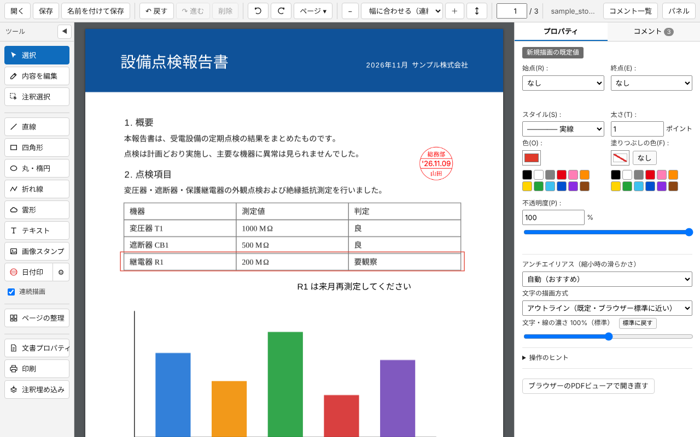

# ローカルPDFエディター

PCに保存したPDFを、ブラウザー（Chrome / Edge）で開いてそのまま編集・保存・印刷できる拡張機能です。
処理はすべてお使いのPCの中で行い、PDFや入力した内容を外部に送信しません（インターネット未接続でも動作します）。

## 主な機能
- **内容の編集**: PDF内の文字の書き換え、図形（ベクター）の移動・拡大縮小・回転・色の変更・削除・複製、配置順の変更
- **注釈**: 直線・矢印・四角形・丸・折れ線・多角形・雲形・テキスト・手書き、画像スタンプ、日付印。Acrobat などで作った直線・折れ線・多角形・雲形の頂点編集
- **ページ**: 回転・並べ替え・挿入・削除・抽出
- **印刷**: 範囲・用紙・倍率・向き・とじしろ・片面／両面を指定（プレビュー付き）
- **その他**: 注釈埋め込み、文書プロパティの編集、編集ロック（権限パスワード）の解除

スキャンした画像の文字認識（OCR）や画像の編集には対応していません。

## インストール（開発版）
1. このリポジトリをダウンロード（または clone）
2. `chrome://extensions`（Edge は `edge://extensions`）を開き、「デベロッパーモード」をオン
3. 「パッケージ化されていない拡張機能を読み込む」でこのフォルダを選択
4. 拡張機能の「詳細」で「ファイルの URL へのアクセスを許可する」をオン

詳しい使い方は [README.txt](README.txt)、変更履歴は [CHANGELOG.txt](CHANGELOG.txt) を参照してください。

## プライバシー
[プライバシーポリシー](https://wolf2064.github.io/local-pdf-editor/privacy.html)

## 使用しているライブラリ
- [PDF.js](https://github.com/mozilla/pdf.js)（Apache License 2.0）— `lib/pdf.min.mjs` は2か所だけ改変（[lib/PATCH-NOTE.txt](lib/PATCH-NOTE.txt)）
- [pdf-lib](https://github.com/Hopding/pdf-lib)（MIT License）
